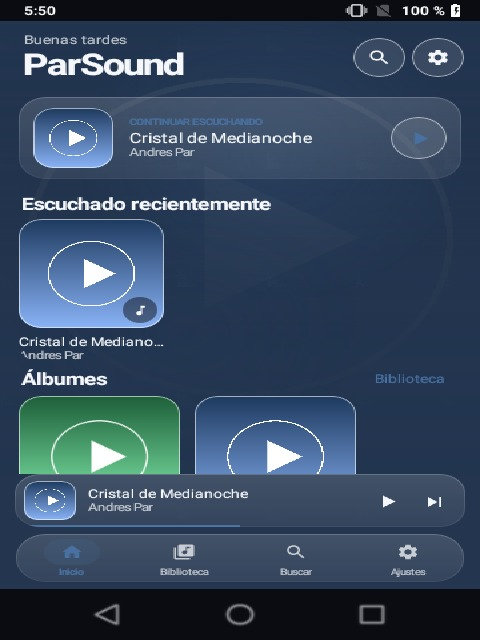
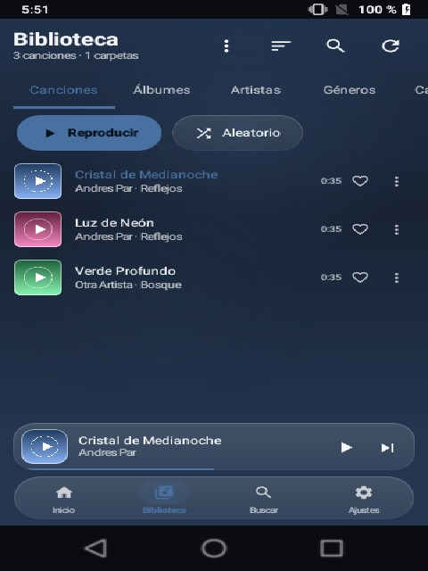
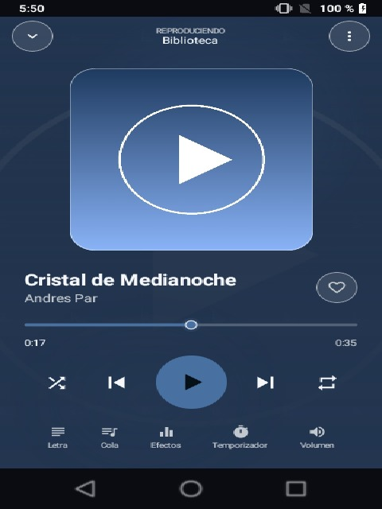
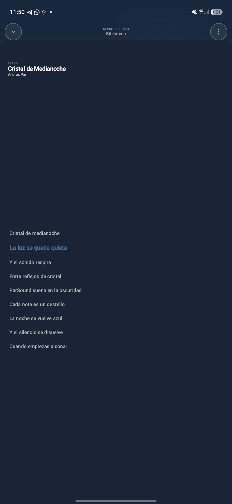
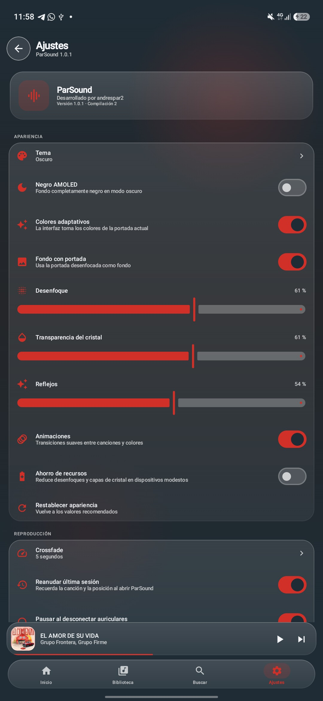
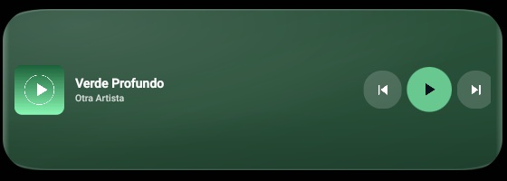

# ParSound

**Música local, con un cristal propio.**

ParSound es un reproductor de música local para Android, desarrollado por
**andrespar2**. Está construido con Kotlin y Jetpack Compose, usa Media3
(ExoPlayer) para la reproducción y aplica un sistema visual *Liquid Glass*
adaptativo: la interfaz toma los colores de la portada de la canción que suena.

Sin anuncios. Sin cuentas. Sin seguimiento. Sin subir tu música a ningún sitio.



## Características

- **Biblioteca local por carpetas** con el selector SAF de Android. ParSound
  conserva el permiso de lectura y solo accede a las carpetas que autorizas.
- **Metadatos reales**: título, artista, álbum, portada, duración, número de
  pista, género, año y archivo de origen. Formatos habituales como MP3, FLAC,
  M4A, OGG, OPUS y WAV, según los decodificadores del dispositivo.
- **Reproducción en segundo plano** con `MediaSessionService`, notificación
  multimedia, pantalla de bloqueo, auriculares Bluetooth y botones multimedia.
- **Crossfade real y configurable** (desactivado, 1–12 s o valor personalizado).
  Usa dos motores ExoPlayer coordinados para solapar el audio sin cortes.
- **Liquid Glass adaptativo** con paleta extraída de la portada, fondos
  dinámicos, superficies translúcidas, reflejos y transiciones animadas.
- **Tema claro, oscuro, AMOLED**, colores automáticos, intensidad de desenfoque,
  transparencia, reflejos, animaciones y modo de ahorro de recursos.
- **Pantalla de reproducción** con portada grande, progreso interactivo,
  aleatorio, repetición, favoritos, cola, letras, efectos, volumen y temporizador.
  El diseño se adapta al tamaño: controles siempre abajo, portada centrada y
  vista previa de la letra debajo cuando hay espacio.
- **Barra de reproducción propia** con progreso en tiempo real, arrastre y toque
  para saltar a cualquier punto de la canción.
- **Letras locales**: archivos LRC junto a la canción y letras incrustadas en
  etiquetas de FLAC, MP3, OGG, M4A y WAV. Sincronización, resaltado de la línea
  actual, desplazamiento automático y vuelta a la posición actual.
- **Recuperación de letras** al reproducir y desde
  **Ajustes → Biblioteca → Buscar letras en los archivos** para toda la biblioteca.
- **Crossfade real** que se aplica al final de cada pista y también al cambiar
  de canción manualmente, desde la notificación, la cola o el widget.
- **Ecualizador real** mediante `android.media.audiofx.Equalizer`, con presets
  del dispositivo y bandas ajustables cuando la salida de audio lo permite.
- **Velocidad y tono** independientes con el procesador Sonic de Media3.
- **Listas de reproducción**, favoritos persistentes, historial, búsqueda,
  ordenación, reanudación de la última sesión y temporizador de apagado.
- **Widgets** compacto, mediano y grande para la pantalla de inicio, con
  márgenes de cristal, portada redondeada y controles de anterior,
  reproducir/pausar y siguiente.
- **Icono adaptativo** original con foreground, background y monocromo.

| Biblioteca | Reproductor | Letras | Ajustes |
|---|---|---|---|
|  |  |  |  |

Widget adaptable con portada, título, artista y controles de anterior,
reproducir/pausar y siguiente:



## Requisitos

- Android 8.0 (API 26) o superior.
- Android 13 o superior: permiso de notificaciones para los controles multimedia.
- Acceso a las carpetas que elijas mediante Storage Access Framework.
- El permiso de audio del sistema es opcional y solo se usa si eliges
  «Importar del dispositivo».

No se necesita conexión a Internet para escuchar música. La aplicación no
declara el permiso `INTERNET`; los enlaces a GitHub y ParDL se abren en el
navegador del sistema.

## Instalación

1. Descarga el APK desde la sección
   [Releases](https://github.com/andrespar2/ParSound/releases/latest).
2. Permite la instalación de aplicaciones de fuentes desconocidas para tu
   navegador o gestor de archivos.
3. Instala y abre ParSound.
4. En **Ajustes → Biblioteca → Carpetas de música**, añade la carpeta donde
   guardas tu música. También puedes importar la biblioteca registrada por
   Android.

## Compilación

Requisitos: JDK 17, Android SDK 35 y Gradle Wrapper incluido.

```bash
./gradlew assembleDebug
```

APK de depuración: `app/build/outputs/apk/debug/app-debug.apk`.

Para una compilación de producción firmada, crea un keystore fuera del
repositorio y añade estas propiedades a `local.properties` (ignorado por Git):

```properties
RELEASE_STORE_FILE=C:/ruta/segura/parsound-release.jks
RELEASE_STORE_PASSWORD=...
RELEASE_KEY_ALIAS=parsound
RELEASE_KEY_PASSWORD=...
```

Después:

```bash
./gradlew assembleRelease
```

La clave privada nunca debe subirse al repositorio.

## Arquitectura

- **Kotlin + Jetpack Compose + Material 3** con componentes de cristal propios.
- **Media3 ExoPlayer** con un reproductor personalizado sobre `SimpleBasePlayer`
  para coordinar dos motores de audio y realizar crossfade.
- **MediaSessionService** para reproducción en segundo plano y controles del sistema.
- **Room** para canciones, listas e historial; **DataStore** para preferencias.
- **Hilt** para inyección de dependencias.
- **Coil** para portadas, **Palette** para la paleta adaptativa.
- **Glance** para widgets, con degradados y colores de la portada.
- Separación pragmática entre datos, escaneo/dominio y presentación; estados
  reactivos con `StateFlow` y una única fuente de verdad para la biblioteca.

## Privacidad y permisos

- La biblioteca se analiza en el dispositivo.
- No hay publicidad ni telemetría.
- Los permisos se solicitan en contexto y solo cuando hacen falta.
- Los archivos se leen a través de URIs autorizadas por el usuario.

## ParDL

ParSound reproduce música local. La opción **Descargar música gratis** de
Ajustes abre [ParDL](https://github.com/andrespar2/ParDL), un proyecto externo
de andrespar2 para descargar audio. ParSound no incluye descargador, no aloja
contenido y no solicita permisos adicionales para esa función. Respeta los
derechos de autor y descarga únicamente contenido legal.

## Limitaciones conocidas

- El desenfoque real del contenido de fondo depende de Android 12+; en versiones
  anteriores se usa un degradado translúcido estable y una portada atenuada.
- Los widgets de Android no permiten desenfoque dinámico. ParSound usa fondos
  translúcidos con los colores de la portada; el redondeo depende del launcher
  (se incluye una máscara de esquinas redondeadas en el propio fondo).
- El ecualizador depende de que el dispositivo exponga el efecto para la sesión
  de audio. Si no está disponible, ParSound lo indica y no muestra controles falsos.
- El crossfade se omite de forma segura en pistas demasiado cortas.
- Algunos launchers antiguos no permiten añadir widgets mediante pin
  (`requestPinAppWidget`); en ese caso se pueden añadir desde el selector de
  widgets del launcher.

## Créditos

**ParSound**  
Desarrollado por **andrespar2**.

Agradecimientos a los proyectos de código abierto que lo hacen posible:
AndroidX, Jetpack Compose, Media3/ExoPlayer, Kotlin, Hilt, Room, DataStore,
Coil, Glance, Palette y DocumentFile. Consulta las licencias completas dentro
de la aplicación: **Ajustes → Información → Licencias de terceros**.

## Licencia

ParSound se distribuye bajo la licencia MIT. Consulta [LICENSE](LICENSE).

Copyright © 2026 andrespar2.
